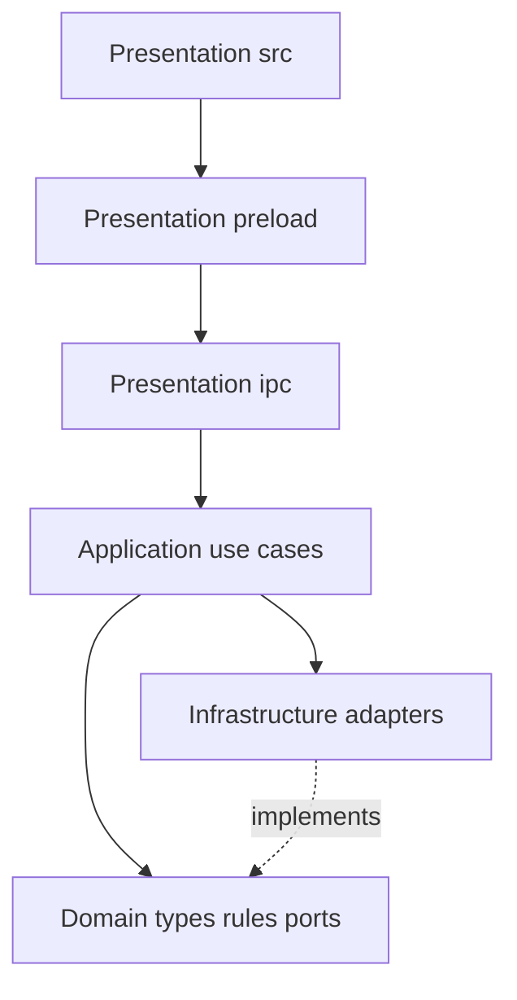

# Architecture — Leyline Reader

Leyline Reader uses a **layered (N-tier) architecture** on the Electron main process, with the React renderer as Presentation.

## Layers

| Layer | Responsibility | Location |
| --- | --- | --- |
| **Presentation** | UI, IPC transport, Zod payload format checks | `src/`, `electron/preload/`, `electron/ipc/` |
| **Application** | Use-case orchestration, unlock gates, DTO shaping | `electron/application/` |
| **Domain** | Pure rules, types, port interfaces (no Electron / hoyoapi) | `electron/domain/` |
| **Infrastructure** | Vault, HoYo HTTP/login, genshin.dev, config, security, auth session | `electron/infrastructure/` |

Composition root: [`electron/main/index.ts`](../electron/main/index.ts) wires adapters and registers IPC.

## Dependency rules

- Presentation → Application (Infrastructure only when a use case would be an empty proxy — e.g. window controls, public config read).
- Application → Domain (types + ports). Implementations are injected or imported from Infrastructure at the composition / use-case wiring edge.
- Domain → **only** `electron/domain/**` (no `electron`, `hoyoapi`, Node filesystem).
- Infrastructure → Domain + Electron/npm libraries.

Enforced by `dependency-cruiser` (`npm run lint:deps`) as part of `npm run check`.

## Security boundary

Process isolation is orthogonal to layering:

- Renderer never receives HoYoverse cookies or tokens.
- Every `ipcMain.handle` validates the sender and Zod-parses payloads (see `AGENTS.md`).
- Domain ports return sanitized DTOs only.

## Use cases (Application)

| Use case | IPC channel(s) |
| --- | --- |
| Auth status / setup / unlock / lock / change password | `AUTH_*` |
| HoYo status / link / unlink | `HOYO_*` |
| Overview / characters / abyss | `DATA_*` |
| GOOD artifacts status / import / clear | `ARTIFACTS_*` |

Window minimize/maximize/close stay in Presentation → Electron APIs (no Application proxy).

## Caching

- **Application TTL cache** (`electron/application/cache/ttl-cache.ts`): keys `overview`, `characters`, `abyss:1`, `abyss:2`; TTL from `hoyo.cacheTtlMs` (default 5 minutes).
- **Force refresh:** IPC `data.*` accepts `{force?: boolean}`; skips cache read when `force: true`.
- **Invalidate:** link success / unlink / lock / app quit (also clears on failed link rollback). Clears the shared Map (TTL + session entries).
- **genshin.dev:** separate in-memory map in Infrastructure with `genshinDev.cacheTtlMs`. Only attach catalog image URLs when the JSON fetch succeeds.
- **Renderer:** `CharacterRosterProvider` shares roster + enrichment between Characters list and detail for the unlocked session; force refresh replaces it; clears on unlink/lock (shell unmount).
- **GOOD artifacts:** persisted encrypted in the vault (`encryptedGoodArtifacts`); independent of HoYo link; survives lock/unlock. Main-process **session** cache key `artifacts:v5` (`setSessionCached`) holds the decrypted + icon-resolved status DTO until import/clear/lock/quit. Renderer `ArtifactsInventoryProvider` mirrors roster session caching for `#/artifacts` (client DTO rev bumps force re-hydrate after icon schema changes).

## Icons (CDN)

| Asset | Primary | Fallback | Resolver |
| --- | --- | --- | --- |
| Character avatars | `hoyo.characterIconBaseUrl` → Enka `…/ui/UI_AvatarIcon_*.png` | `hoyo.characterIconFallbackBaseUrl` → HoYoLab | `electron/domain/hoyo/icons.ts` |
| Artifact relics | `hoyo.artifactIconBaseUrl` → Enka `…/ui/UI_RelicIcon_{setId}_{slot}.png` | `hoyo.artifactIconFallbackBaseUrl` → HoYoLab | `electron/domain/good/icons.ts` + `set-ids.ts` |

CSP `img-src` must allow `enka.network` (and HoYoLab upload hosts) via `security.allowedImageHosts`. Renderer never invents catalog URLs; DTOs carry `icon` / `iconFallback` / `locationIcon` / `locationIconFallback`.

Prayer one-piece sets use Enka/game `_3` icon suffix (not circlet `_5`).

## Presentation notes

- Routes: Overview, Characters (`#/characters`, `#/characters/:characterKey`), Artifacts (`#/artifacts` — GOOD JSON import), Abyss, Settings (plus Login).
- Characters filter state: React Router search params (`q`, `element`, `weapon`, `sort`).
- Artifacts: unlock-only (no `AccountGate`); import/browse GOOD `artifacts[]`; filters `q` / `slot` / `equipped`. Search uses a local input draft + `useDeferredValue` / debounced URL sync so typing stays responsive over large grids. See [`TODO.md`](../TODO.md).
- Theme: `next-themes` in the renderer (`leyline-theme` localStorage); Appearance controls on Settings.
- Visual accents: Moegirl-aligned CSS tokens in `src/index.css`; compose with shadcn `Card` / `Badge` (`StatChip`, `MetricCard`, `RarityStars`). Locked artifact chips use shadcn `Badge variant="destructive"`.
