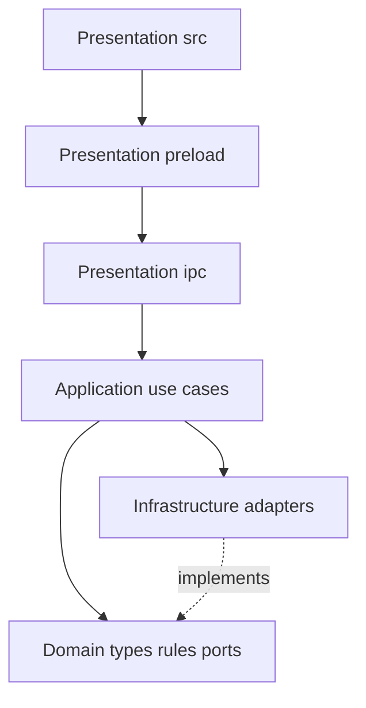

# Architecture — Leyline Reader

Leyline Reader uses a **layered (N-tier) architecture** on the Electron main process, with the React renderer as Presentation.

## Layers

| Layer | Responsibility | Location |
| --- | --- | --- |
| **Presentation** | UI, IPC transport, Zod payload format checks | `src/`, `electron/preload/`, `electron/ipc/` |
| **Application** | Use-case orchestration, unlock gates, DTO shaping | `electron/application/` |
| **Domain** | Pure rules, types, port interfaces (no Electron / hoyoapi) | `electron/domain/` |
| **Infrastructure** | Vault, HoYo HTTP/login, genshin.dev, config, security, auth session | `electron/infrastructure/` |

Composition root: [`electron/main/index.ts`](../electron/main/index.ts) wires adapters and registers IPC.

## Dependency rules

- Presentation → Application (Infrastructure only when a use case would be an empty proxy — e.g. window controls, public config read).
- Application → Domain (types + ports). Implementations are injected or imported from Infrastructure at the composition / use-case wiring edge.
- Domain → **only** `electron/domain/**` (no `electron`, `hoyoapi`, Node filesystem).
- Infrastructure → Domain + Electron/npm libraries.

Enforced by `dependency-cruiser` (`npm run lint:deps`) as part of `npm run check`.

## Security boundary

Process isolation is orthogonal to layering:

- Renderer never receives HoYoverse cookies or tokens.
- Every `ipcMain.handle` validates the sender and Zod-parses payloads (see `AGENTS.md`).
- Domain ports return sanitized DTOs only.

## Use cases (Application)

| Use case | IPC channel(s) |
| --- | --- |
| Auth status / setup / unlock / lock / change password | `AUTH_*` |
| HoYo status / link / unlink | `HOYO_*` |
| Overview / characters / abyss | `DATA_*` |

Window minimize/maximize/close stay in Presentation → Electron APIs (no Application proxy).

## HoYo data caching

- **Application TTL cache** (`electron/application/cache/ttl-cache.ts`): keys `overview`, `characters`, `abyss:1`, `abyss:2`; TTL from `hoyo.cacheTtlMs` (default 5 minutes).
- **Force refresh:** IPC `data.*` accepts `{force?: boolean}`; skips cache read when `force: true`.
- **Invalidate:** link success / unlink / lock / app quit (also clears on failed link rollback).
- **genshin.dev:** separate in-memory map in Infrastructure with `genshinDev.cacheTtlMs`. Only attach catalog image URLs when the JSON fetch succeeds.
- **Renderer:** `CharacterRosterProvider` shares roster + enrichment between Characters list and detail for the unlocked session; force refresh replaces it; clears on unlink/lock (shell unmount).

## Presentation notes

- Routes: Overview, Characters (`#/characters`, `#/characters/:characterKey`), Abyss, Settings (plus Login).
- Characters filter state: React Router search params (`q`, `element`, `weapon`, `sort`).
- Theme: `next-themes` in the renderer (`leyline-theme` localStorage); Appearance controls on Settings.
- Avatars: Domain icon resolution (`electron/domain/hoyo/icons.ts`) + config `hoyo.characterIconBaseUrl`; CSP `img-src` from `security.allowedImageHosts`.
- Visual accents: Moegirl-aligned CSS tokens in `src/index.css`; compose with shadcn `Card` / `Badge` (`StatChip`, `MetricCard`, `RarityStars`).
